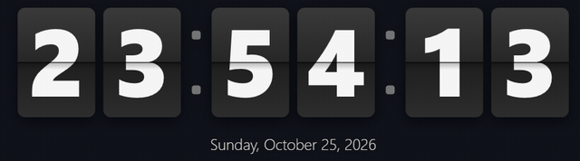
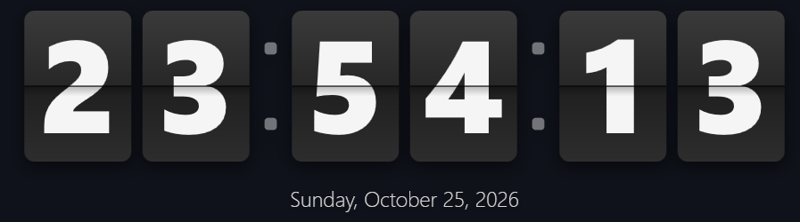

# FlipClock

A desktop flip clock for Windows in the classic HTC Sense style, built with WPF.
Cards physically flip every second, the date sits underneath, and the app lives
in the system tray — no taskbar button, no Alt-Tab entry.





## Features

- Flip-card clock, accurate to the second: the top flap folds down over the old
  digit, the bottom flap unfolds the new one, with animated shading
- Localized date line and AM/PM markers, formatted from the Windows locale
  (UI strings follow the UI language: Chinese on zh-\* systems, English otherwise)
- Show/hide seconds, 12/24-hour clock, always-on-top, start-with-Windows
- Size slider, 40%–160%
- Tray-resident: left-click toggles visibility, right-click for the menu
- Ticks aligned to the system clock once per second — no cumulative drift
- Digits optically centered (the glyph is shifted out of the font's descender space)
- ~35 KB single executable, runs on any Windows 10/11 with the built-in
  .NET Framework 4.8 — nothing to install

## Download

Grab `FlipClock.exe` from [Releases](../../releases), or build it yourself.

## Build

The project compiles with the C# compiler that ships inside Windows — no
Visual Studio, no .NET SDK, no NuGet. Just double-click (or run) `build.cmd`.

## Usage

| Action | Effect |
| --- | --- |
| Drag the clock | Move it (position is remembered) |
| Tray left-click | Show / hide the clock |
| Tray or clock right-click | Menu: hide, always on top, settings, exit |
| Settings → OK / Apply / Cancel | Changes take effect only on OK or Apply |

Start arguments:

- `/settings` — open the settings window on launch
- `/culture:en-US` — override UI language and date format for this run

Settings are stored in `%LOCALAPPDATA%\FlipClock\settings.ini`; auto-start
writes the per-user `HKCU\Software\Microsoft\Windows\CurrentVersion\Run` key.

## Implementation notes

- Each digit card is four layers: a static top half, a static bottom half, a
  top flap carrying the old digit that folds down, and a bottom flap carrying
  the new digit that unfolds. Shading gradients sell the fold.
- Digit glyphs sit low inside a font's line box (space reserved for
  descenders), so the control measures baseline and line height at runtime and
  shifts the glyph up to the optical center of the card.
- The tray icon is a miniature flip card drawn with GDI+ at runtime; the exe
  icon is generated by `tools/makeicon.ps1`. No binary resources in the repo.
- Source is written in C# 5 to stay compatible with the in-box compiler.

## Repository layout

```
src/            Program.cs, FlipDigit.cs, SettingsWindow.cs, Strings.cs, TrayIcon.cs
tools/          build-time and dev scripts (icon generator, capture/measurement helpers)
docs/           README images
build.cmd       one-click build
```

## License

[MIT](LICENSE)
